# 如何管理用户和用户组

OpenPAI支持2种身份验证模式来管理用户和组：

- 基础认证模式
- AAD模式

## 基础认证模式

在默认情况下，OpenPAI使用基础认证模式。
基础认证模式中的用户组是和虚拟集群直接绑定的（关于如何设置虚拟集群，请参考[这个文档](./how-to-set-up-virtual-clusters.md)）。
此外，OpenPAI默认有两个用户组：`default`和`admingroup`，它们在OpenPAI部署完成时就已经创建好了。所有用户都属于`default`用户组，并且有`default`虚拟集群的访问权限。所有管理员属于`admingroup`用户组，有所有虚拟集群的访问权限。假设您创建了一个`test-vc`虚拟集群，并且管理员把这个集群授权给了某个用户。那么这个用户就会在`test-vc`用户组中了。

例如，您若在[Webportal](./basic-management-operations.md#user-management)上添加了一个管理员，那么这个管理员就会在`default`和`admingroup`组中。如果添加的是非管理员，那么他一开始只会在`default`组中。假设管理员给了这个新用户（非管理员）`new-vc`的访问权限，那么他就会在`default`和`new-vc`两个组中。

在用户资料页，用户可以看到他所在的用户组。想要查询的话，点击页面右上角的`View my profile`。

   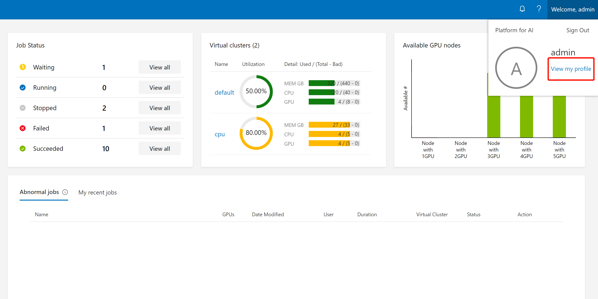

接着用户的组就会被显示出来了（参考下面图片中的红框）:

   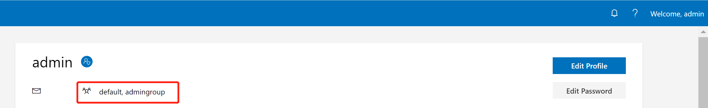

对于用户管理，请转到`Administration` -> `User Management`。 

## AAD模式

[Microsoft Azure 目录服务 (Azure Active Directory, AAD)](https://docs.microsoft.com/en-us/azure/active-directory/fundamentals/active-directory-whatis) 是Microsoft的基于云的身份和访问管理服务。
可以将OpenPAI配置为使用AAD模式进行用户身份验证。
在AAD模式下，您可以使用AAD身份验证token登录OpenPAI群集。

在本节中，我们将逐步介绍如何设置AAD认证模式。 

### 准备工作

- 如果您在基础认证模式下已经设置过一些用户，您需要手动将他们迁移至AAD。一旦AAD认证设置成功，您将不能使用原先的基础认证。
- 要设置AAD，请先按照[这里](./basic-management-operations.md#how-to-set-up-https)的说明为OpenPAI设置HTTPS访问。

### 设置AAD

- 登录 [Azure Web portal](https://ms.portal.azure.com/), 依次选择 Azure Acive Directory -> App registrations -> New registration
  <div align="center">
  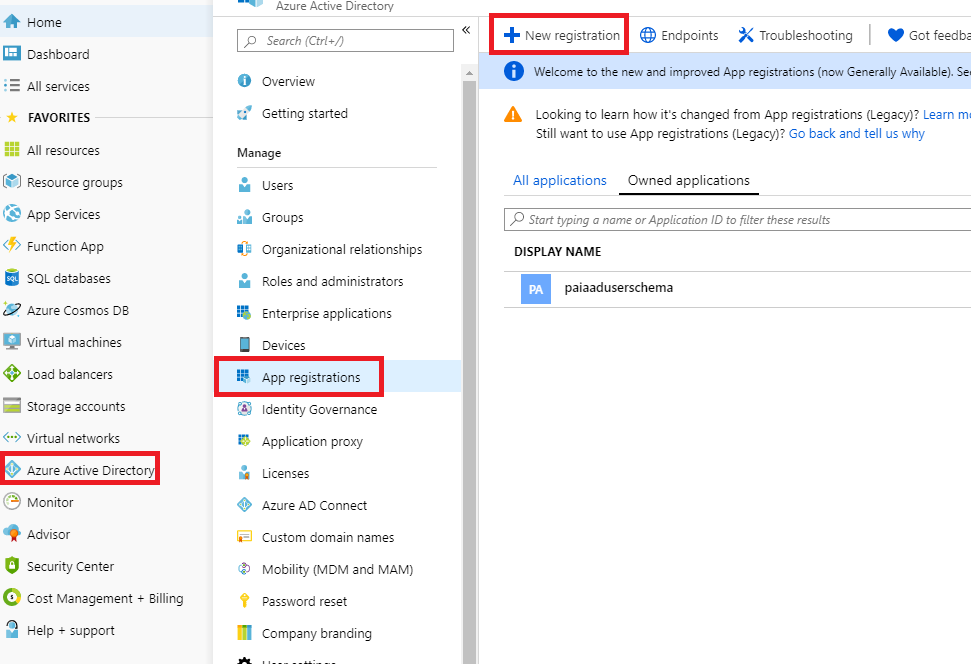
  </div>

- 为您的应用设置一个名称，并完成注册。
  <div align="center">
  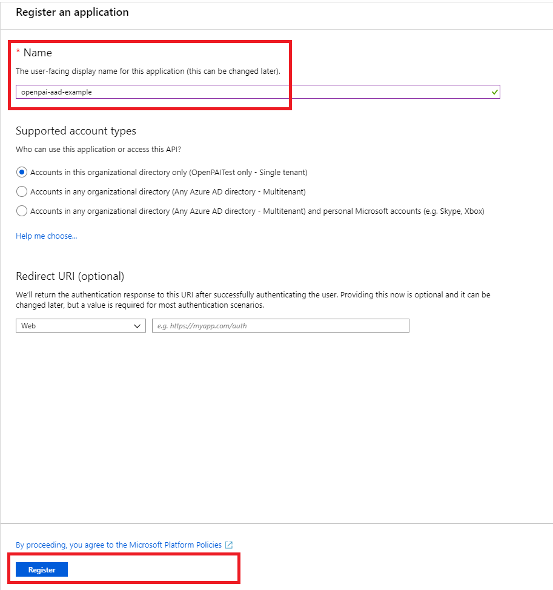
  </div>

- 找到您刚刚注册的应用并打开。
  <div align="center">
  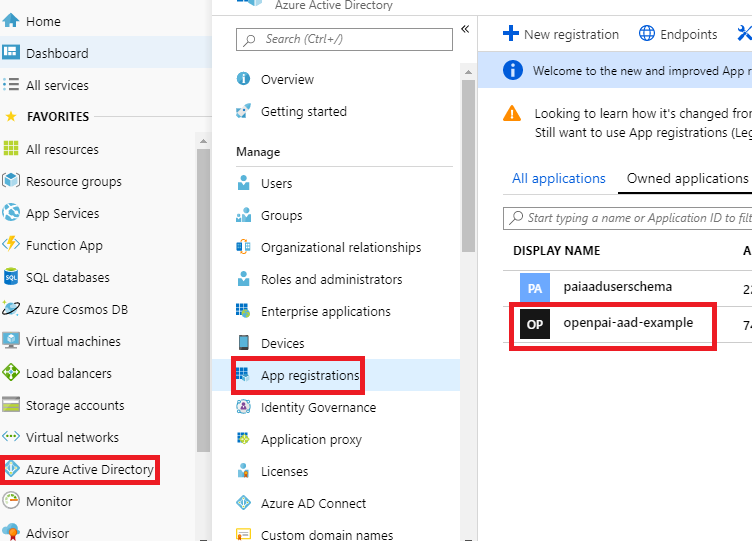
  </div>

- Authentication: 设置OpenPAI的跳转URI。跳转URI应该是 `https:/pylon_address/rest-server/api/v1/authn/oidc/return`
<div align="center">
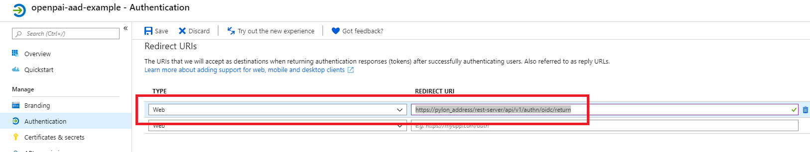
</div>

- Certificates & secrets: 创建一个新的client serect。 将secret value记为 `${secret_value}`. 
**复制新的client secret值。执行其他操作或离开此页面后，您将无法再获取它**
  <div align="center">
  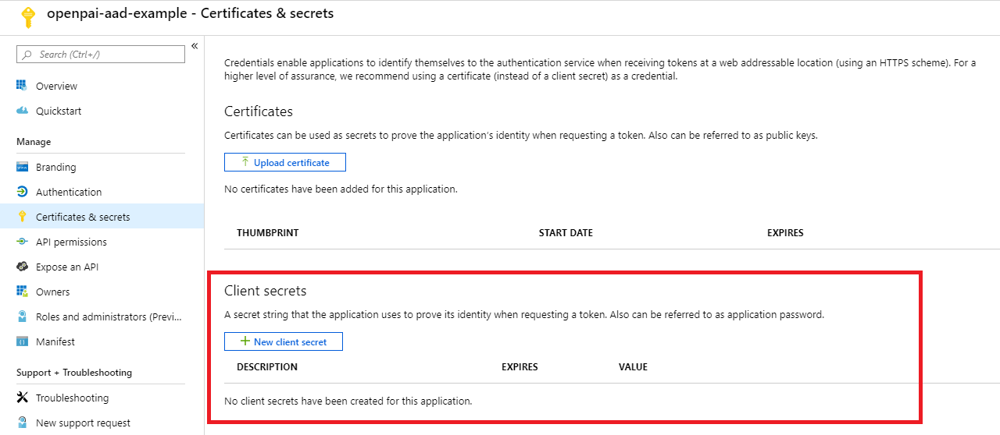
  </div>
  <div align="center">
  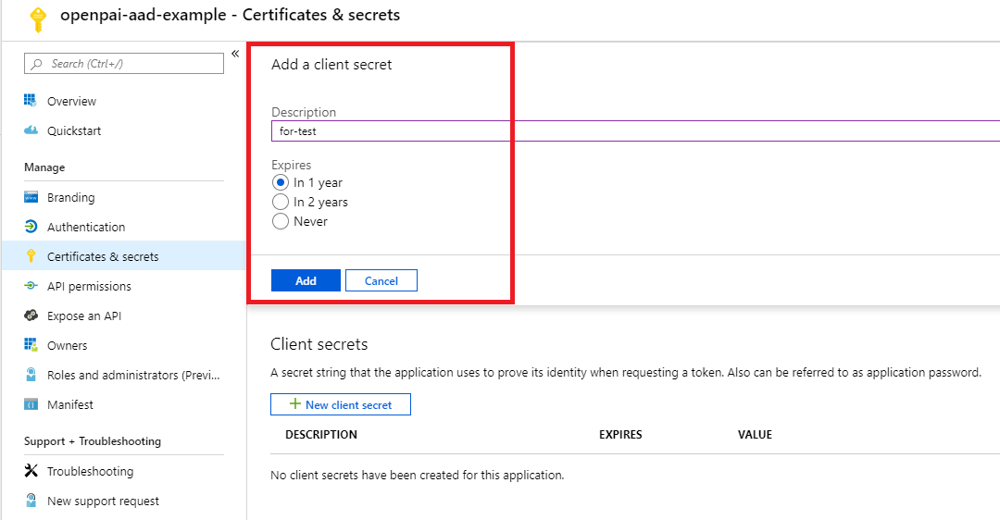
  </div>
  <div align="center">
  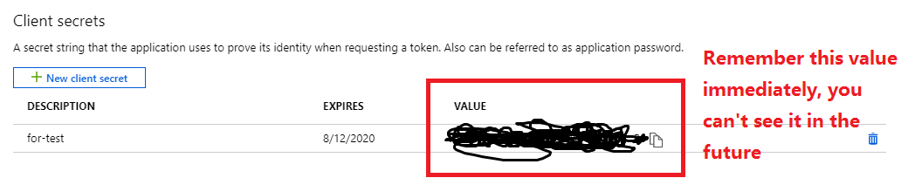
  </div>

- API permissions: 请如下图所示添加权限。如果Azure AD是由您刚刚创建的，那么您可以自己设置权限，否则需要让您的管理员进行设置。
  <div align="center">
  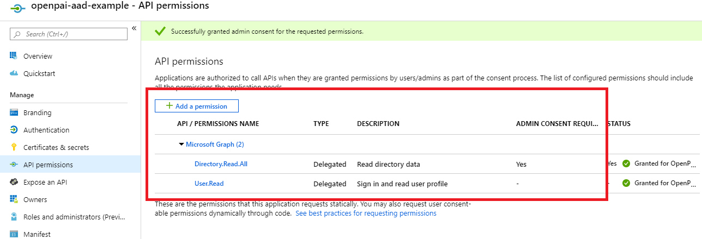
  </div>

- Quickstart: 记住下面的值
    - Application (client) ID： 记为`${app_id}`
    - Directory (tenant) ID， 记为`${tenant_id}`
    - 在endpoints' view中， 找到OpenID Connect metadata 文档，记为`${well_known}`
  <div align="center">
  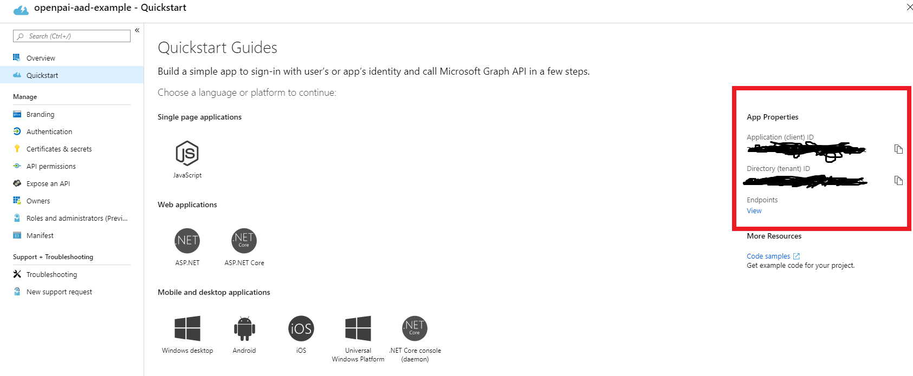
  </div>

### 服务配置

根据下面的示例，修改 `services-configuration.yaml`. 

```yaml
authentication:
  OIDC: true
  OIDC-type: AAD
  AAD:
   wellKnownURL: ${well_known}
   tenantID: ${tenant_id}
   clientID: ${app_id}
   clientSecret: ${secret_value}
   nonceLifetime: null
   nonceMaxAmount: 10
   clockSkew: null

  group-manager:
    group-data-source: ms-graph

    # Admin group name and its user list
    admin-group:
      # The group name showed in the OpenPAI system.
      groupname: admingroup
      description: "admin's group"
      # The group alias (groupname) in Azure Active directory
      externalName: "team_alias_a"

    # Group for default vc.
    default-group:
      groupname: default
      description: "group for default vc"
      externalName: "team_alias_b"
    # If you cluster you have configured several other VCs, except default VC (it has been created in the default-group), you should configure group for each VC in the following list
    grouplist:
    - groupname: forexample1
      description: forexample1
      externalName: "team_alias_c"
    - groupname: forexample2
      description: forexample2
      externalName: "team_alias_d"
```

### 使用 AKS 托管身份认证

REST Server 支持通过用户分配的托管身份（UAMI）认证现有 Entra 应用，
替代客户端密钥或证书。用户登录流程、应用权限和回调地址保持不变。

先将 MI 分配到承载每个 REST Server 实例的计算资源，使其可以通过原生托管身份端点
（Azure VM 上为 IMDS）获取令牌。在 AKS 上应使用隔离的服务节点池，不应绑定到运行
用户训练任务的节点。同节点上其他能访问 IMDS 的工作负载也可能使用该身份。
生产部署前，需确认身份绑定方式的 AKS 支持边界和节点升级生命周期；
直接修改 VMSS 不等同于 AKS 管理的工作负载身份绑定。

只需在应用上配置一条联合身份凭据（FIC）：

| 配置位置 | Issuer | Subject | Audience |
| --- | --- | --- | --- |
| Entra 应用 | `https://login.microsoftonline.com/<tenant-id>/v2.0` | 托管身份的 **principal/object ID**，不是 client ID | `api://AzureADTokenExchange` |

应用与托管身份必须属于同一个租户。多个集群共用 MI 时，将 MI 分配到各集群的服务计算资源，
应用上只需添加一条对该 MI 的信任。仅为完成此认证流程，不需要向 MI 分配 Azure RBAC 角色。

不要通过 AKS Workload Identity 获取此 MI 令牌：Entra 不允许将通过一条 FIC 获取的令牌
再作为另一条 FIC 的凭据（`AADSTS700231`）。此模式不依赖 AKS OIDC、投射的
ServiceAccount token 或 AKS 到 MI 的 FIC。

在 `services-configuration.yaml` 中移除 `clientSecret` 或 `certificate`，改为：

```yaml
authentication:
  OIDC: true
  OIDC-type: AAD
  AAD:
    wellKnownURL: https://login.microsoftonline.com/<tenant-id>/v2.0/.well-known/openid-configuration
    tenantID: <tenant-id>
    clientID: <existing-application-client-id>
    credentialType: managedIdentity
    managedIdentity:
      clientID: <user-assigned-managed-identity-client-id>
    # 其余 OIDC 和 group-manager 配置保持不变。
```

部署不再为 REST Server Pod 添加 Workload Identity 标签，并会移除
`rest-server-account` 上之前的 MI client ID 和 tenant 注解。
重新应用 REST Server 部署以替换仍带有旧 Webhook 注入的 Pod。
如果仍注入 `AZURE_FEDERATED_TOKEN_FILE`，REST Server 会拒绝启动，
避免 SDK 在使用 `ManagedIdentityCredential` 时仍自动选择联合认证。
删除已有 AKS 到 MI 的 FIC 前，需确认没有其他调用方。

REST Server 通过 `ManagedIdentityCredential` 显式选择配置的用户分配托管身份，获取
`api://AzureADTokenExchange/.default` 的令牌，再将其作为应用凭据交换用户的授权码。
它使用节点原生托管身份，不使用开发者凭据，也不会在失败时回退到密钥或证书。
MI 模式不再分发 OIDC 证书；证书检查组件不再挂载 OIDC 证书，但保留网站 HTTPS 证书检查。

未设置 `credentialType` 的配置保持原有密钥/证书行为，也可显式指定 `clientSecret` 或
`certificate`。所有调用方迁移完成、回滚窗口结束后，才移除旧凭据或旧 SN+I 信任。
仅添加 MI 信任不会清理应用上的不安全凭据。此次凭据迁移不需要清除现有用户数据。

### 清除旧数据

请删除老的用户数据（即基础认证模式中的用户登录信息）。在AAD模式中，老用户数据已经用不到了。

```bash 
./paictl.py service delete -n rest-server
```

### 更新配置并重启集群

完成上述所有步骤之后，请更新配置并重新启动所有OpenPAI服务： 

```bash
./paictl.py service stop
./paictl.py config push -p <config-folder> -m service
./paictl.py service start
```

### 验证

在rest-server启动后，您可以根据下面的步骤检查AAD是否被成功设置。

- 在K8S中，namespace `pai-group`和`pai-user-v2`被成功创建了。
  <div align="center">
  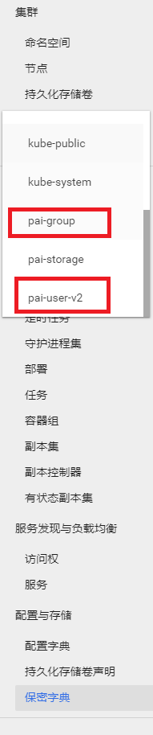
  </div>

- 在配置中的用户组被成功创建，它们被保存在`pai-group`namespace下的secret里。
  <div align="center">
  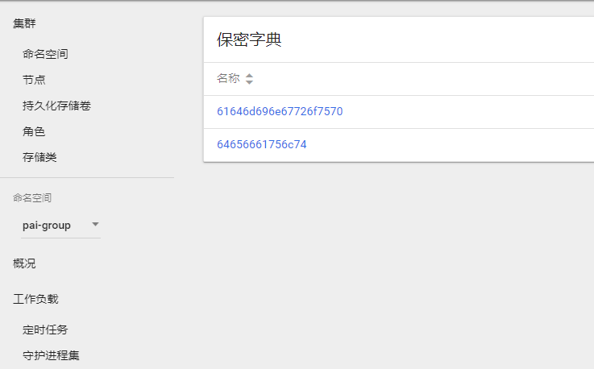
  </div>

- 每个组都有一个`acls`字段。
  <div align="center">
  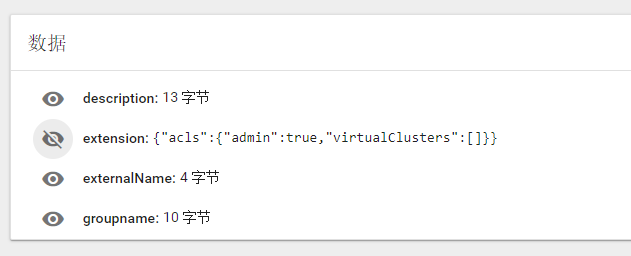
  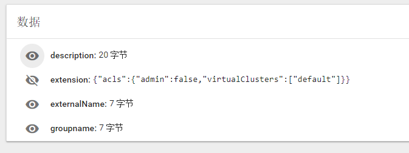
  </div>

- 请登录OpenPAI的Webportal，检查您的用户数据是否在`pai-user-v2` namespace下的secret里。
  <div align="center">
  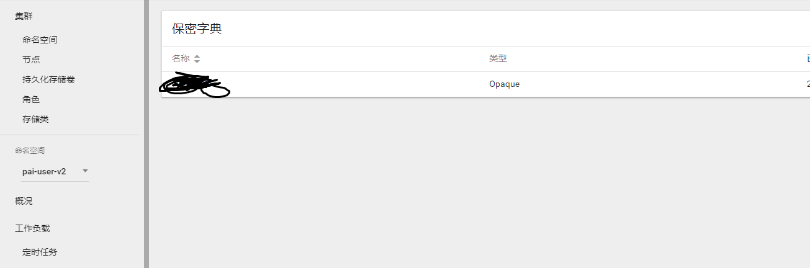
  </div>

- 请检查用户的数据。它们应该有一个空的extension字段，和一个非空的grouplist字段。
  <div align="center">
  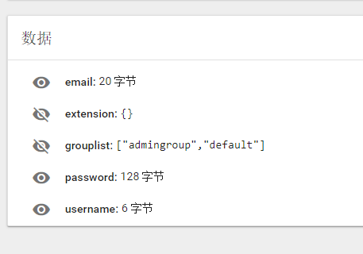
  </div>

- 在默认虚拟集群中提交一个任务, 在其他虚拟集群中也提交一个任务。

- 请检查管理员可以访问管理员页面。
  <div align="center">
  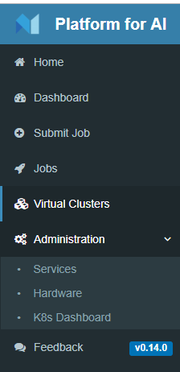
  </div>

- 请重新配置一个新的虚拟集群，对应的用户组也会被创建。
  <div align="center">
  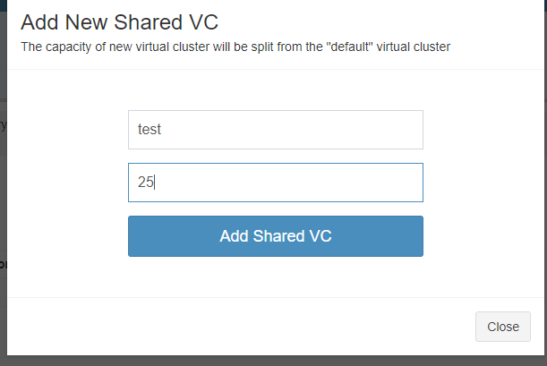
  </div>

  <div align="center">
  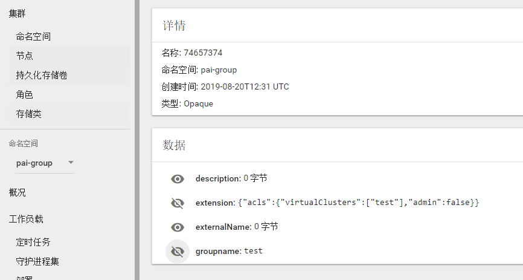
  </div>

- 管理员用户可以在主页中看到新创建的VC。
  <div align="center">
  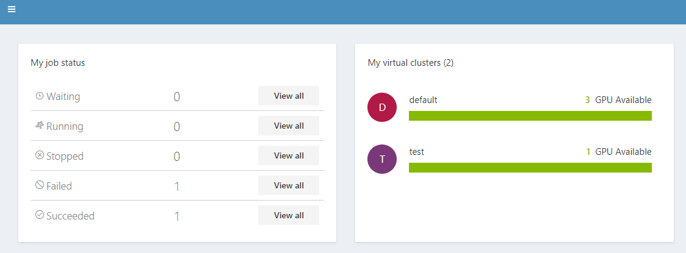
  </div>

- 请删除新集群，对应的用户组会被删除。
  <div align="center">
  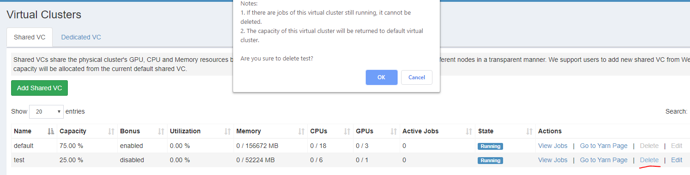
  </div>

- 删除虚拟集群后, 相应的组会从 `pai-group` secrets中移除.
  <div align="center">
  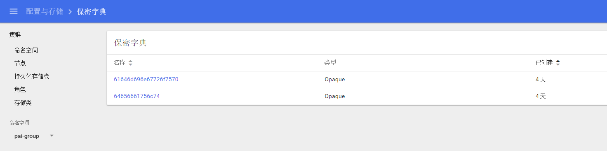
  </div>

### 故障排除

如果验证失败的话，您可以尝试去删除rest server服务，然后重启它再进行尝试。
依旧不行的话，请[在Github上提交issue](https://github.com/microsoft/pai/issues/new/choose)，并提供相应的信息。
